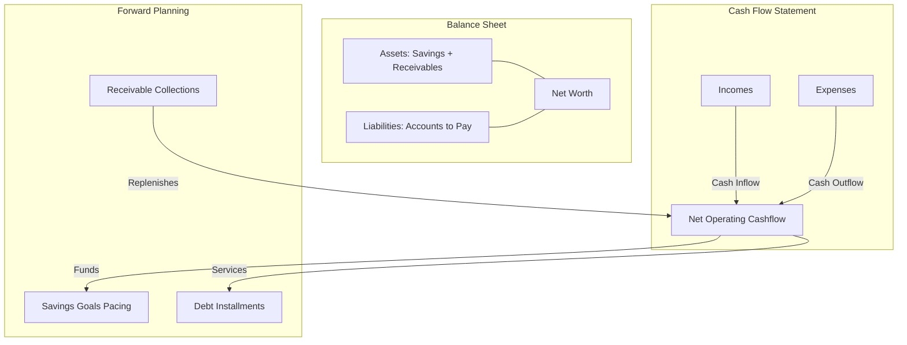
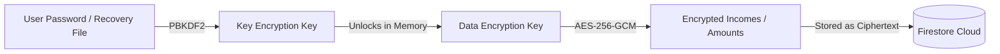

# web-personal-finances

Personal finances Flutter web app

- **Flutter**: 3.38.9
- **Dart**: 3.2.5

Run locally:

```bash
fvm flutter run -d Chrome
```

Run tests and analysis:

```bash
fvm flutter analyze
fvm flutter test
```

## Structure

```text
lib/
└── feature/
    ├── bloc/
    │   ├── bloc.dart
    │   ├── event.dart
    │   └── state.dart
    ├── model/
    │   └── model.dart
    ├── repository/
    │   └── repository.dart
    ├── widget/
    │   ├── body.dart
    │   └── (any required widget related to body)
    └── screen.dart
```

---

## 1. The Macro Picture: A True Financial Operating System

The application represents an institutional-grade **Personal Balance Sheet & Cash-Flow Operating System**, capturing the full cash-flow cycle and balance sheet dynamics:



### Core Financial Foundations:

1. **Cash Flow Statement**:
   - $\text{Net Operating Cashflow} = \text{Received Incomes} - \text{Operating Expenses}$
2. **Personal Balance Sheet**:
   - $\text{Net Worth} = (\text{Liquid Savings} + \text{Accounts Receivable}) - \text{Accounts to Pay (Liabilities)}$
3. **Forward Planning & Pacing**:
   - Reconciles monthly cash generation with mandatory debt servicing (Accounts to Pay) and goal commitments (Savings).

---

## 2. Flow-by-Flow Professional Assessment

### 💵 Incomes (`incomes/`) — _Cash-Flow Engine_

- **Purpose**: Tracks operational inflows, revenue streams, and earning capacity.
- **Key Capabilities**:
  - Distinguishes between **received liquidity** and **scheduled/pending inflows**.
  - Normalizes frequencies (bi-weekly, monthly, annual, one-time) into an accurate **Monthly Projected Earning Power**.
- **Financial Value**: Eliminates the "lumpy income trap" by providing a smoothed, dependable baseline regardless of irregular bonuses or commission payments.

### 💳 Expenses (`expenses/`) — _Operational Burn Rate_

- **Purpose**: Tracks cash outflows and categorical expenditures.
- **Key Capabilities**:
  - Real-time monthly burn rate calculations.
  - Expense categorization to identify fixed essential commitments vs. discretionary spending.
- **Financial Value**: Establishes the exact burn rate required for emergency runway calculations and budget adherence.

### 📑 Accounts to Pay (`accountsToPay/`) — _Liability & Debt Servicing_

- **Purpose**: Manages short- and long-term debt obligations, loans, credit cards, and fixed bills.
- **Key Capabilities**:
  - **Dual Amortization Engine**:
    - **French System (Declining Balance)**: Dynamic principal/interest breakdown for formal banking loans and mortgages.
    - **Flat Rate (Simple Interest)**: Fixed interest calculation across installments for informal personal loans and retail installment contracts.
  - **30-Day Due Window & Overdue Tracking**: Proactive alerts for bills due soon and past-due aging.
  - Quota payment tracking against principal and interest.
- **Financial Value**: Avoids treating debt as a generic expense by accurately separating **principal reduction** (which increases net worth) from **interest fees** (cost of debt).

### 🤝 Accounts Receivable (`accountsReceivable/`) — _Credit & Counterparty Risk_

- **Purpose**: Tracks money owed to the user by debtors, clients, family, or friends.
- **Key Capabilities**:
  - Symmetrical dual amortization schedule (French & Flat Rate).
  - Quota completion indicators, partial collections, and overdue aging badges.
  - Full collection movement statement.
- **Financial Value**: Prevents informal loan leakage—ensuring personal loans and client receivables are monitored and recovered rather than forgotten.

### 🎯 Savings & Goals (`savings/`) — _Capital Accumulation & Liquidity Buffer_

- **Purpose**: Builds emergency buffers and milestone capital.
- **Key Capabilities**:
  - **Closed-Ledger System**: $\text{Current Liquid Balance} = \text{Initial Balance} + \sum(\text{Deposits}) - \sum(\text{Withdrawals})$.
  - **Dynamic Deadline Pacing**: Computes required monthly contributions:
    $$\text{Monthly Needed} = \frac{\text{Goal Amount} - \text{Current Balance}}{\text{Months Remaining Until Target Date}}$$
  - 10 curated goal categories (_Emergency Fund, Vacation, Vehicle, Real Estate, Education, Retirement, Investment, Tech, Health, Other_).
  - Balance safety validations preventing over-withdrawals.
- **Financial Value**: Shifts savings from passive residual funds into an active, milestone-driven investment roadmap.

---

## 3. Architecture & UX Polish

| Dimension                         | Standard & Implementation Details                                                                                                                                                            |
| :-------------------------------- | :------------------------------------------------------------------------------------------------------------------------------------------------------------------------------------------- |
| **Architectural Uniformity**      | Every flow strictly adheres to the BLoC pattern (`BaseState`, events, reactive states), Firestore repository isolation under `/users/{uid}/*`, clean domain models, and decoupled UI layers. |
| **Multi-Currency (HNL / USD)**    | Dual-currency native support tailored for emerging markets. Every module dynamically computes dual KPI cards and aggregates balances for primary and secondary currencies.                   |
| **Design System & Glassmorphism** | Unified color tokens (`DarkColors`, `LightColors`, `white`), responsive data tables (`CustomDataTable`), toolbar inline filters, dismissible filter chips, and interactive KPI tooltips.     |
| **Bilingual Localization**        | 100% parity across English (`en.json`) and Spanish (`es.json`) without hardcoded UI strings.                                                                                                 |
| **Code Quality & Testing**        | Zero analyzer warnings (`fvm flutter analyze`), with unit and widget tests covering financial calculations, amortizations, and KPI generators.                                               |

---

## 4. Zero-Knowledge Client-Side Encryption

To guarantee institutional-grade privacy and ensure sensitive financial data is completely shielded from database administrators, cloud personnel, or compromised credentials, Pecunia implements **Zero-Knowledge Application-Layer Envelope Encryption**:



- **True Zero-Knowledge**: Sensitive income fields (`amount`, `name`, `comment`) are encrypted on the client device using **AES-256-GCM** before touching Firestore. Decryption keys live exclusively in browser memory during an active session. Metadata needed for security rules and queries (such as `userId`, `currency`, dates and status flags) remains in plaintext. Encryption is currently piloted on **Incomes**; other modules are planned in the roadmap.
- **Envelope Encryption**: The Data Encryption Key (DEK) is encrypted with keys derived from the user's password and an emergency recovery phrase via **PBKDF2** (HMAC-SHA256, 100k iterations).
- **Emergency Kit Workflow**:
  - **Mandatory Download on Onboarding**: During initial onboarding, the user must download their Emergency Key file (`pecunia_recovery_key_<email>.txt`) to proceed.
  - **Always Accessible in Profile**: The recovery key file can be re-downloaded at any time from the Profile screen.
  - **Dedicated Gatekeeper Route (`/vault-recovery`)**: If a user resets their password, the router locks the entire app behind a dedicated Gatekeeper screen until they upload their emergency key file or 12-word phrase. The password is verified against Firebase before the vault is re-encrypted, so the vault password always matches the account password.
  - **Legacy Account Migration (`/vault-setup`)**: Existing accounts created before encryption was introduced are seamlessly intercepted upon login and prompted to initialize their vault and download their Emergency Key without re-doing general onboarding.
- **Detailed Specification**: See [ZERO_KNOWLEDGE_ENCRYPTION.md](ZERO_KNOWLEDGE_ENCRYPTION.md) for full cryptographic details, field partitioning, BLoC architecture, and rollout roadmap.
