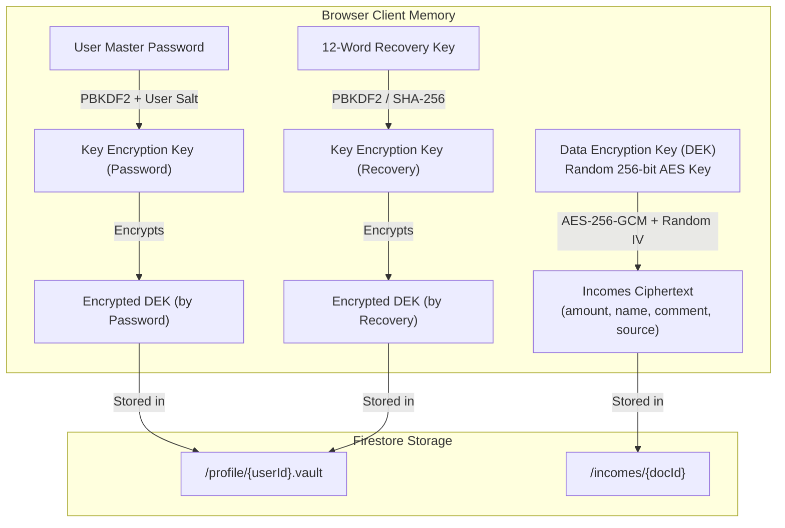
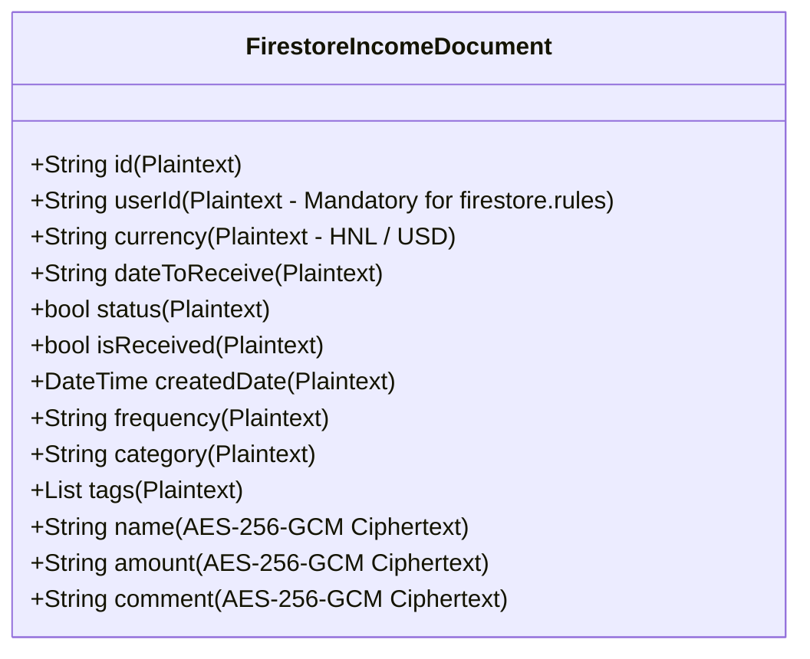

# Zero-Knowledge Client-Side Encryption Architecture

## 1. Executive Summary & Threat Model

Personal financial records (income amounts, transaction names, creditors, and sensitive notes) require the highest standard of data privacy. While standard cloud configurations protect data in transit (TLS 1.3) and enforce multi-tenant isolation via [firestore.rules](file:///Users/tectrans-danielalvarez/Documents/projects/web_personal_finances/firestore.rules), database administrators or compromised cloud credentials can still inspect plaintext database records in the Firebase Console.

This specification outlines the **Zero-Knowledge Application-Layer Client-Side Encryption (Envelope Encryption)** system for Pecunia.

### Core Privacy Guarantees

- **Zero-Knowledge**: The encryption and decryption keys exist exclusively in the client's browser memory during an active session. Neither Firebase, Google Cloud, nor database administrators possess the ability to decrypt user financial records.
- **User-to-User Isolation**: Maintained strictly at the infrastructure level via [firestore.rules](file:///Users/tectrans-danielalvarez/Documents/projects/web_personal_finances/firestore.rules).
- **Admin Visibility**: Cloud database entries for sensitive fields appear as authenticated cryptographic ciphertext (AES-GCM).

---

## 2. Cryptographic Architecture: Envelope Encryption

To achieve zero-knowledge security without sacrificing multi-device web access or risking unrecoverable data loss, Pecunia utilizes **Envelope Encryption**:



### Key Components

| Component                       | Identifier  | Algorithm                             | Purpose                                                                                                                  |
| :------------------------------ | :---------- | :------------------------------------ | :----------------------------------------------------------------------------------------------------------------------- |
| **Data Encryption Key**         | **DEK**     | AES-256 (256-bit symmetric)           | Encrypts and decrypts transaction data (`amount`, `name`, `comment`, `source`). Generated randomly upon user onboarding. |
| **Password Key Encryption Key** | **KEK-P**   | PBKDF2 (HMAC-SHA256, 100k iterations) | Derived from the user's login password and a unique per-user salt. Encrypts the DEK for everyday multi-device login.     |
| **Recovery Key Encryption Key** | **KEK-R**   | PBKDF2 / BIP-39                       | Derived from a 12-word cryptographic recovery phrase. Encrypts the DEK as an emergency fallback envelope.                |
| **Ciphertext Payload**          | **AES-GCM** | AES-GCM (12-byte IV + Tag)            | Authenticated Encryption with Associated Data (AEAD), ensuring confidentiality and tamper resistance.                    |

---

## 3. Emergency Kit & Recovery Key Workflow

### A. Onboarding: Mandatory Recovery Key Download

During the initial onboarding wizard:

1. The app generates the user's random **12-word Recovery Key** and initializes the **DEK**.
2. A dedicated **"Security & Encryption Vault"** step is presented to the user.
3. The user is prompted to click **"Download Emergency Key (`pecunia_recovery_key_<email>.txt`)"**.
4. **Mandatory Gate**: The "Complete Onboarding" button remains **disabled** until the file has been successfully downloaded.
5. The encrypted vault payload (`encryptedKeyByPassword`, `encryptedKeyByRecoveryPhrase`, `salt`) is stored in Firestore `/profile/{userId}`.

#### Structure of the Downloaded Emergency Key File (`.txt`):

```text
=====================================================
         PECUNIA PERSONAL FINANCES - EMERGENCY KEY
=====================================================
Account Email : user@example.com
Account UID   : 8xK91jL02mN4...
Created Date  : 2026-10-21

RECOVERY KEY:
ocean timber flame silver castle winter apple cloud river sunset gold anchor

IMPORTANT INSTRUCTIONS:
1. Store this emergency key in a safe, secure location (e.g. password manager, USB drive).
2. If you forget your password, you will need this file to recover and decrypt your financial records.
3. Pecunia employees cannot recover or reset your data without this key.
=====================================================
```

### B. Profile Screen: Persistent Re-Download

Inside the [Profile screen](file:///Users/tectrans-danielalvarez/Documents/projects/web_personal_finances/lib/profile/widget/profile_body.dart), a **Security & Vault** card provides:

- Live status indicator: `Zero-Knowledge Encryption: Active`.
- **"Download Backup Recovery Key"** button to export a fresh copy of the emergency file at any time while authenticated.

### C. Password Reset & Vault Gatekeeper Route (`/vault-recovery`)

Because Firestore security rules require authentication (`request.auth.uid == userId`) to read or write user vault records, password recovery follows the industry-standard authenticated Zero-Knowledge Gatekeeper pattern (used by 1Password, Proton, and Apple Advanced Data Protection):

1. **Password Reset Email**:
   - On the Login screen, the user clicks **"Forgot Password?"**, inputs their email, and Firebase Auth sends a secure password reset link.
   - The user sets their new password securely via the Firebase reset page.
2. **Authenticated Login with New Password**:
   - The user returns to the app and signs in with their new password.
   - `LoginBloc` marks the unlock as in progress (`SessionVault.beginUnlock()`) **before** calling Firebase, so the router does not gate the app while the login-time unlock is still running (PBKDF2 takes a moment).
   - The client attempts to unlock the vault with the login password. Since the vault in Firestore was encrypted with the _old_ password, PBKDF2/AES-GCM decryption fails.
   - `LoginBloc` stores the login password in `SessionVault.pendingAuthPassword` and calls `SessionVault.endUnlock()`, which notifies the router.
3. **Dedicated Gatekeeper Redirect (`/vault-recovery`)**:
   - The GoRouter redirect guard detects that the authenticated user has an encrypted vault, no active key, and no unlock in progress (`authNotifier.isVaultLocked == true`).
   - The router locks access to the entire application (`/home`, `/incomes`, `/expenses`, etc.) and redirects the user to the full-screen **Vault Recovery Gatekeeper** (`/vault-recovery`).
   - Because the login password is already held in memory, the screen does **not** ask for it again.
4. **Key Verification & Vault Re-encryption**:
   - On the Gatekeeper screen, the user uploads their `pecunia_recovery_key_<email>.txt` file or enters their 12-word recovery phrase.
   - **Password verification**: `VaultRecoveryBloc` first calls `AuthRepository.verifyPassword(...)` (Firebase re-authentication). The vault is only ever re-encrypted with a password confirmed to be the real account password, so the vault password cannot drift from the login password.
   - `EncryptionService.unlockVaultWithRecoveryPhrase(...)` recovers the master DEK.
   - The client derives a fresh Key Encryption Key (KEK) from the verified password and re-encrypts the DEK.
   - The re-encrypted vault is saved to Firestore, the temporary password is wiped from memory (`clearPendingAuthPassword()`), a fresh Emergency Key file is downloaded automatically, and `authNotifier.refreshProfile()` is called.
   - The router redirect automatically unlocks the app and transitions the user into `/home`.
   - If the page is refreshed while on the Gatekeeper, the in-memory password is gone, so the screen asks for the current sign-in password. It is verified against Firebase before use; a wrong password is rejected.
5. **Fresh Vault Fallback (Permanent Loss)**:
   - If the user permanently lost their Emergency Key, the screen provides a controlled **"Reset Vault & Start Fresh"** option with explicit warnings. It also requires a verified password and creates a brand new vault. Previously encrypted records cannot be recovered without the original key.

### D. Existing Accounts Migration: Dedicated Setup Route (`/vault-setup`)

Accounts created before the introduction of Zero-Knowledge encryption lack a `vault` map in their Firestore user document (`userProfile.vault == null`). To ensure 100% of users are protected without forcing existing users to re-do the general onboarding questions (currency, birth date, profession), a dedicated migration gatekeeper is used:

1. **Detection on Login**:
   - `LoginBloc` notes that the authenticated user profile exists but lacks a `vault`. It retains the verified login password in `SessionVault.pendingAuthPassword`.
   - `AppAuthNotifier.isVaultSetupRequired` evaluates to `true` (`_userProfile != null && _userProfile.vault == null && !isUnlockInProgress`).
2. **Dedicated Gatekeeper Redirect (`/vault-setup`)**:
   - `GoRouter` intercepts the user before reaching `/home` and redirects them to the full-screen **Vault Setup** screen (`/vault-setup`).
   - The user cannot bypass this screen or access protected views until their vault is initialized.
3. **Emergency Key Generation & Download**:
   - A fresh 12-word recovery phrase is generated for the account.
   - The user is required to click **"Download Emergency Key (.txt)"** before proceeding; the submit action remains locked until the file is downloaded.
4. **Vault Initialization**:
   - `VaultSetupBloc` verifies the account password with Firebase (`AuthRepository.verifyPassword`). If the user navigated via a direct link or page reload, they can type their login password into the provided field.
   - A fresh DEK is generated and encrypted using the verified password and recovery phrase.
   - The user profile document in Firestore is updated with the new `vault` map.
   - Session keys are set in `SessionVault`, temporary passwords cleared, and `authNotifier.refreshProfile()` is called.
   - The router automatically detects the vault is now present and active, redirecting the user to `/home`.

---

## 4. Field Partitioning (Pilot: Incomes Flow)

To preserve database indexing, security rules verification, and real-time streams, documents are partitioned into **Plaintext Fields** and **Encrypted Fields**:



### Plaintext Fields (Currently Unencrypted):

- `id`, `userId`: `userId` is **required** by [firestore.rules](file:///Users/tectrans-danielalvarez/Documents/projects/web_personal_finances/firestore.rules#L23-L24) to authenticate ownership (`resource.data.userId == request.auth.uid`) and by the `where('userId', ...)` query.
- `currency`: Enables dual-currency filtering without downloading foreign records.
- `dateToReceive`, `createdDate`: Preserve date range handling.
- `status`, `isReceived`: Preserve active/received flags.
- `frequency`, `category`, `tags`: Used for grouping and KPIs. They can reveal the nature of an income, so they are candidates for a later encryption phase.

### Encrypted Fields (AES-256-GCM):

- `amount`: Number encoded to string, then encrypted into ciphertext.
- `name`: Income title / employer name.
- `comment`: User notes and transaction remarks.

Each ciphertext string carries its own random 12-byte IV, so there is no separate `iv` field. Records written before encryption was enabled (or while no key was available) are stored as plain values and are still read correctly.

---

## 5. Software Architecture & Implementation Plan

The client-side encryption is implemented with clean separation of concerns adhering to **SOLID principles**:

```text
lib/
├── commons/
│   ├── bloc/
│   │   └── app_auth_notifier.dart      # Router notifier exposing `isVaultLocked`
│   └── security/
│       ├── bip39_words.dart            # BIP-39 English wordlist for recovery phrases
│       ├── encryption_service.dart     # AES-GCM 256-bit crypto + PBKDF2 engine
│       ├── file_picker_helper.dart     # Platform file picking for emergency key files
│       ├── recovery_key_utils.dart     # Key file generation, parsing & download helpers
│       └── session_vault.dart          # In-memory session key holder (cleared on logout)
├── routes/
│   ├── landing_constants.dart          # Defines `vaultRecoveryRoute` & `vaultSetupRoute`
│   └── landing_routes.dart             # GoRouter redirect guards gating app access
├── vaultRecovery/
│   ├── bloc/
│   │   ├── vault_recovery_bloc.dart    # Pure BLoC coordinating recovery & reset logic
│   │   ├── vault_recovery_event.dart   # VaultRecoveryUnlockSubmitted & VaultRecoveryResetSubmitted
│   │   └── vault_recovery_state.dart   # Initial, InProgress, Success, Failure states
│   ├── vault_recovery_screen.dart      # Screen providing VaultRecoveryBloc
│   └── widget/
│       └── vault_recovery_body.dart    # Form validation & response handling (file download, snackbars)
└── vaultSetup/
    ├── bloc/
    │   ├── vault_setup_bloc.dart       # Pure BLoC coordinating legacy vault creation
    │   ├── vault_setup_event.dart      # VaultSetupSubmitted
    │   └── vault_setup_state.dart      # Initial, InProgress, Success, Failure states
    ├── vault_setup_screen.dart         # Screen providing VaultSetupBloc
    └── widget/
        └── vault_setup_body.dart       # Mandatory key download check & password confirmation
```

### 1. `EncryptionService` & `SessionVault`

- Provides `encryptString`, `decryptString`, `encryptAmount`, and `decryptAmount`.
- Uses authenticated **AES-256-GCM** with a fresh 12-byte IV per encryption operation.
- **Backward Compatibility**: Automatically detects if an incoming record is legacy plaintext or ciphertext, allowing seamless operation on existing test records without database wipes.
- `SessionVault`: Singleton in-memory store (also a `ChangeNotifier`) that holds the decrypted `SecretKey`, the recovery phrase, the temporary login password and an `isUnlockInProgress` flag. It is purged upon logout and never persisted to browser storage.

### 2. Router-Level Gatekeeper Guards (`landing_routes.dart` & `AppAuthNotifier`)

- **Vault Lock Guard**: `AppAuthNotifier.isVaultLocked` is `true` when a user has a vault in Firestore (`userProfile?.vault != null`), the session lacks the decrypted DEK (`!hasActiveKey`), and no login-time unlock is running (`!isUnlockInProgress`). Redirects immediately to `/vault-recovery`.
- **Vault Setup Guard**: `AppAuthNotifier.isVaultSetupRequired` is `true` when an onboarded user has a profile but no vault (`userProfile != null && userProfile.vault == null && !isUnlockInProgress`). Redirects immediately to `/vault-setup`.
- `AppAuthNotifier` listens to `SessionVault`, so lock state is re-evaluated when `endUnlock()` or `clear()` is called.
- Once a vault is unlocked or created, `AppAuthNotifier.refreshProfile()` is called, immediately re-evaluating the redirect and transitioning the user to `/home`.

### 3. `VaultRecoveryBloc` & `VaultSetupBloc` (SOLID Architecture)

- **BLoCs (`VaultRecoveryBloc`, `VaultSetupBloc`)**: Strictly contain business and cryptographic coordination logic. They receive pre-validated inputs, verify passwords through `AuthRepository.verifyPassword`, delegate to `EncryptionService` and `UserRepository`, manage session keys, and emit distinct state transitions.
- **Bodies (`VaultRecoveryBody`, `VaultSetupBody`)**: Responsibilities are strictly kept on the UI layer:
  - Form validation: Verifies that recovery phrases/files are valid, mandatory emergency key download has occurred, and passwords are provided before dispatching events.
  - Response handling: Listens to success states to trigger emergency key downloads, display snackbars, and refresh auth profiles.

### 4. Transparent Incomes Repository Integration

In [incomes_repository.dart](file:///Users/tectrans-danielalvarez/Documents/projects/web_personal_finances/lib/incomes/repository/incomes_repository.dart):

- **On Write (`addIncome` / `updateIncome`)**: Encrypts sensitive fields (`name`, `comment`, `amount`) using the session DEK right before writing to Firestore.
- **On Read (`getIncomes`)**: Intercepts Firestore snapshots and decrypts fields before emitting domain `IncomeItem` models to [IncomesBloc](file:///Users/tectrans-danielalvarez/Documents/projects/web_personal_finances/lib/incomes/bloc/incomes_bloc.dart).
- **Result**: [incomes_body.dart](file:///Users/tectrans-danielalvarez/Documents/projects/web_personal_finances/lib/incomes/widget/incomes_body.dart) and [incomes_table.dart](file:///Users/tectrans-danielalvarez/Documents/projects/web_personal_finances/lib/incomes/widget/incomes_table.dart) require **zero** modifications.

### 5. Automated Test Coverage

The encryption system is fully tested with automated unit tests under `test/`:

- `test/encryption_service_test.dart`: Validates 256-bit DEK generation, AES-GCM string encryption/decryption, float amount encryption/decryption, legacy plaintext passthrough, password and recovery phrase vault derivation, and session key clearing.
- `test/vault_recovery_bloc_test.dart`: Validates initial BLoC states and error handling when a user vault does not exist (with a faked `AuthRepository.verifyPassword`).
- `test/vault_setup_bloc_test.dart`: Validates initial BLoC states and error handling when profile is missing during vault initialization.

---

## 6. Phased Rollout Roadmap

1. **Phase 1 (Current Pilot)**:
   - Implement `EncryptionService`, `SessionVault`, and recovery file generation.
   - Wire transparent encryption/decryption into `incomes/`.
   - Add mandatory key file download to `onboarding/`.
   - Add re-download action in `profile/`.
2. **Phase 2 (Liabilities & Expenses)**:
   - Extend encryption to `expenses/` (amounts, vendors, comments).
   - Extend encryption to `accountsToPay/` (creditor names, quota balances, notes).
3. **Phase 3 (Assets & Goals)**:
   - Extend encryption to `accountsReceivable/` (debtor names, collections).
   - Extend encryption to `savings/` (goal names, balances, target amounts).
