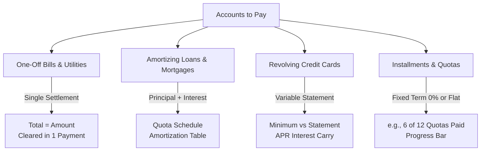
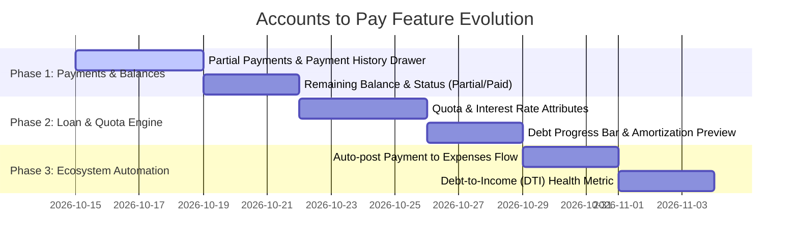

# 💳 Financial Analysis & Strategic Improvement Plan: Accounts to Pay (Liabilities & Debt Management)

> **Role & Perspective:** Senior FinTech Product Architect & Financial Analyst  
> **Target Module:** Accounts to Pay (`accountsToPay/`)  
> **Date:** October 2026  

---

## 1. Executive Summary: The Structural Gap

In personal finance apps, treating an **Account to Pay** purely as a flat transaction with a single `amount` and a binary `isPaid` flag is one of the most common pitfalls:

* **The Problem:** If you have an auto loan of **$15,000** with monthly quotas of **$350**, clicking *"Mark as Paid"* on a single invoice marks the entire $15,000 liability as settled, or forces the user to manually compute and type $350 each month without tracking principal payoff progress.
* **The Solution:** Differentiating between **One-off Bills / Invoices** (e.g., Electric bill, Supplier invoice) and **Structured Liabilities / Debt Facilities** (Amortizing Loans, Revolving Credit Cards, Fixed Installments).

---

## 2. Taxonomy of Accounts to Pay

Different liabilities require distinct data models and financial calculations:

| Type | Examples | Core Metrics Needed | Settlement Behavior |
| :--- | :--- | :--- | :--- |
| **One-Off Bill** | Electricity, Water, Supplier invoice, Freelance contractor | `amount`, `dueDate` | 1 payment settles 100% of the bill. |
| **Amortizing Loan** | Auto loan, Personal bank loan, Mortgage | `originalPrincipal`, `annualInterestRate`, `termMonths`, `monthlyQuota`, `remainingBalance` | Each quota payment splits into Principal reduction + Interest expense. |
| **Credit Card** | Visa / Mastercard statement | `statementBalance`, `minimumPayment`, `cutoffDate`, `paymentDueDate`, `apr` | Can pay Full Balance, Minimum, or Custom amount. |
| **Fixed Installments** | Electronics, Furniture (e.g., 6, 12, 24 quotas) | `totalAmount`, `numberOfQuotas`, `quotaAmount`, `currentQuotaNumber` | Each payment advances quota counter: $4/12 \rightarrow 5/12$. |

---

## 3. High-Impact Suggested Improvements

### A. Partial Payments & Payment History (Ledger)
Instead of a single boolean `isPaid`, support partial payments:
* **Sub-ledger records**: `AccountPayment { id, accountId, amountPaid, paymentDate, paymentMethod, referenceNumber, notes }`.
* **Dynamic Balances**:
  $$\text{Remaining Balance} = \text{Total Amount} - \sum \text{Payments Made}$$
* **Status Enum**: `Pending` $\rightarrow$ `Partially Paid` $\rightarrow$ `Paid / Settled` (or `Overdue`).
* **UI**: A quick "Make Payment" action modal where the user inputs the amount paid today, automatically deducting from the remaining balance and logging the transaction.

---

### B. Loan & Installment Calculator (Quota Engine)
For items categorized as `Loan` or `Rent / Mortgage`:
1. **Inputs**:
   * Initial Principal ($P$)
   * Annual Interest Rate ($r\%$)
   * Loan Duration in Months ($n$)
2. **Standard French Amortization Formula**:
   $$\text{Monthly Quota} = P \times \frac{i(1 + i)^n}{(1 + i)^n - 1} \quad \text{where } i = \frac{r}{12}$$
3. **Visual Progress Bar**: Shows "% of Debt Liquidated" (e.g., *L. 45,000 of L. 100,000 paid — 45%*).

---

### C. Cross-Module Synergy: Auto-linking with Expenses (`expenses/`)
When a user clicks **"Record Payment"** in Accounts to Pay:
* An optional checkbox: **`[x] Log as Expense in Expenses Module`**.
* Automatically creates an entry in `expenses/` with category matching the liability (e.g., `Category: Housing` or `Category: Other`), preventing manual double-entry.
* Deducts money from the user’s designated Bank Account or Cash Wallet.

---

### D. Enhanced Strategic KPIs
In addition to the current 4 KPIs (*Pending, Overdue, Due in 30 Days, Paid*), introduce:

1. **Debt-to-Income (DTI) Ratio**:
   $$\text{DTI} = \left( \frac{\text{Monthly Debt Commitments}}{\text{Normalized Monthly Income}} \right) \times 100\%$$
   * **Healthy:** $< 35\%$
   * **Warning:** $36\% - 49\%$
   * **Critical:** $\ge 50\%$
2. **Weighted Average Interest Rate (Cost of Debt)**:
   * Displays the effective average interest the user is paying across all active loans and cards.
3. **Monthly Debt Service Obligation**:
   * Total required cash needed each month strictly for debt quotas and minimum payments.

---

### E. UI/UX Enhancements
* **Payment Drawer / Modal**: Click a dollar icon next to any account $\rightarrow$ enter payment amount, date, and payment method $\rightarrow$ instantly updates remaining balance.
* **Account Detail Expandable Row / View**: Click on a loan to see:
  - Original principal vs Remaining balance.
  - History of all payments made to date.
  - Projected debt-free date.
* **Debt Payoff Simulator (Snowball vs. Avalanche)**:
  - **Snowball**: Pay smallest balances first for psychological momentum.
  - **Avalanche**: Pay highest interest rate first for maximum mathematical savings.

---

## 4. Phased Implementation Roadmap

